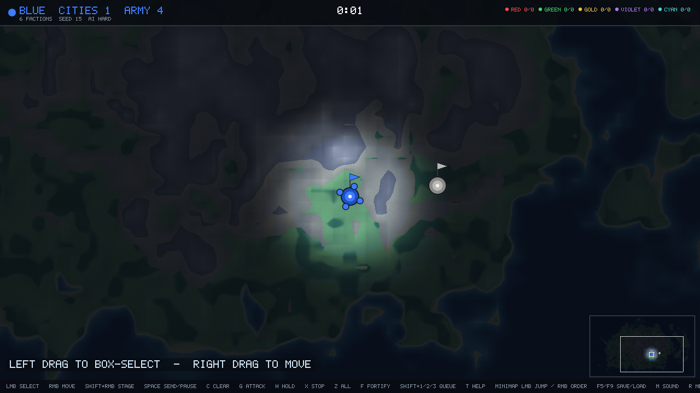

# War of Dots — offline C edition

A small single-player RTS in C, inspired by the Python [War of Dots](https://github.com/gamepycoder/War-of-dots-) in this repository.
You command blue dots, the computer commands red dots, and the whole match runs offline on one machine.

No game engine, no assets, no image libraries: the game draws into a 32-bit framebuffer and
presents it through Xlib, so the only build dependencies are a C compiler, `make`, and `libX11`.



## Features

- Procedurally generated island every match (value-noise elevation + forest layer, sea border)
- Five terrain types with real gameplay effects: plains, forest, hill, water, impassable mountain
- Selection (click, shift-add, box select), hand-drawn movement paths, and formation offsets
- Fog of war with explored-terrain memory, terrain-scaled vision (hills see far, forests short),
  enemy units hidden outside your sight, and a matching fogged minimap
- Mountain-aware routing: clear path segments are kept exactly as drawn, blocked ones are
  replaced by a BFS grid route so units never wedge themselves against a cliff
- Cities: capture by presence/majority, unit production, rally points for new units
- Supply system: units heal near friendly cities, starve far away or behind enemy lines
- Offline AI that defends threatened cities, masses waves, and attacks the nearest target
- Camera pan/zoom, minimap, pause, restart, win screen
- Headless AI-vs-AI mode for testing, balance work, and regression checks

## Build

```sh
cd c_rts
make
```

Requirements: `gcc` (or clang), `make`, and the X11 development headers
(Debian/Ubuntu: `sudo apt install build-essential libx11-dev libxext-dev`).

## Play

```sh
./wod_c                 # new random match vs the red AI
./wod_c --seed 42       # reproducible map
```

The game starts paused — press `SPACE` to begin.

| Input | Action |
| --- | --- |
| Left click | Select a unit, shift-click to add, click a city to select it |
| Left drag | Box-select your units |
| Right drag | Draw a path for the selection (or a rally path for a selected city) |
| `Z` | Select all your units |
| `A` `D` / `W` `S`, arrows | Pan the camera |
| Middle drag | Pan the camera |
| Mouse wheel | Zoom around the cursor |
| `SPACE` | Pause / resume |
| `ESC` | Clear selection |
| `R` | Restart with a new random map |
| `Q` | Quit |

## Rules in one screen

- **Terrain**: plains 100 % speed / 100 % damage, forest 80 % / 75 %, hills 70 % / 150 %,
  water 60 % / 50 %. Mountains cannot be crossed.
- **Fog of war**: you only see what your dots and cities can see. Vision is 105 px on plains,
  165 px on hills, 80 px in forest, plus 200 px around your cities. Areas you have explored stay
  dimly visible as terrain memory, but enemy dots disappear into the fog. City locations and
  ownership are always known.
- **Combat** is automatic: every dot attacks the closest enemy within range, once per frame,
  scaled by the terrain it stands on. There is no manual attack button.
- **Cities** flip after 2 seconds when one side has more units inside the capture radius
  (a full uncontested capture is faster than a contested one). Ownership resets the city's
  production timer. Units inside an owned city heal; far from any owned city they lose health.
- **Production**: each owned city spawns a dot every `7 + 0.22 × army_size` seconds, up to
  60 dots per player. New dots follow the city's rally path if one was drawn.
- **Win**: a player with no cities and no units loses. The match timer stops on the win screen.

## Headless mode

```sh
./wod_c --headless 180 --seed 3
```

Runs both sides as AI for up to 180 simulated seconds, printing map stats, city positions,
periodic army summaries, and the result. This is how the simulation was smoke-tested
(`RED WINS ... blue 0 cities/0 units ...`) and is useful when tuning constants.

## Code layout

```
src/common.h   tuning constants, Vec2 helpers, Unit/City types, terrain enums
src/world.h/c  noise, island generation, terrain queries, BFS router
src/game.h/c   match setup, city capture/production, selection, player orders
src/units.c    movement, separation, supply, combat
src/ai.h/c     offline opponent (defend, gather, attack)
src/render.h/c terrain pre-render, terrain blit, units, cities, paths, selection box
src/hud.c      top bar, minimap, help, selection info, pause/win overlays
src/gfx.h/c    framebuffer primitives: AA discs, thick lines, triangles, text
src/font.h/c   5x7 bitmap font
src/main.c     X11 window, double-buffered MIT-SHM presentation, input, camera,
               fixed-step loop, headless mode
```

Simulation is fixed at 60 Hz (`SIM_DT`), display syncs to the same rate. All match tuning lives
in `src/common.h` (terrain modifiers, speeds, damage, capture time, production, supply).
Rendering runs at 1280×720 but is resolution-independent — change `WIN_W`/`WIN_H` in `main.c`.

## Known limitations / next steps

- The AI has full map knowledge (fog applies to the player only).
- One AI personality and no difficulty levels; it is deliberately aggressive.
- No sound, no map/save loading, no network play.
- The AI is tuned by simulation, not by long human playtesting.
- `libX11` only: macOS/Windows would need a different presenter (`render_world`/`render_hud`
  are independent of the window system and only need a pixel buffer).
